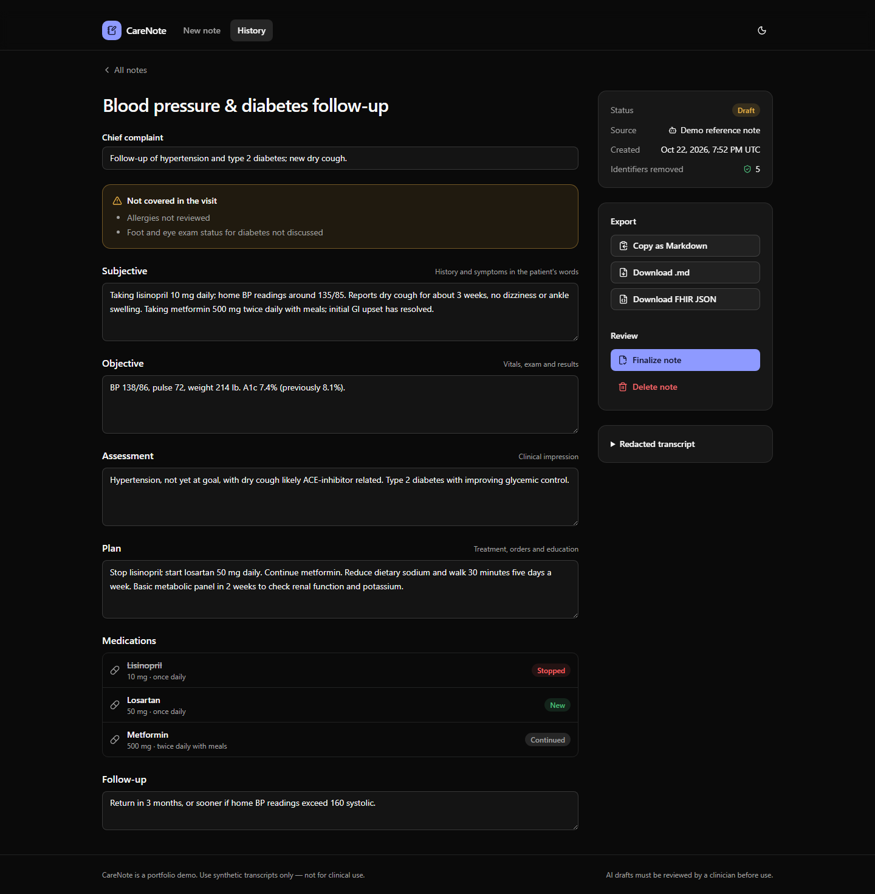
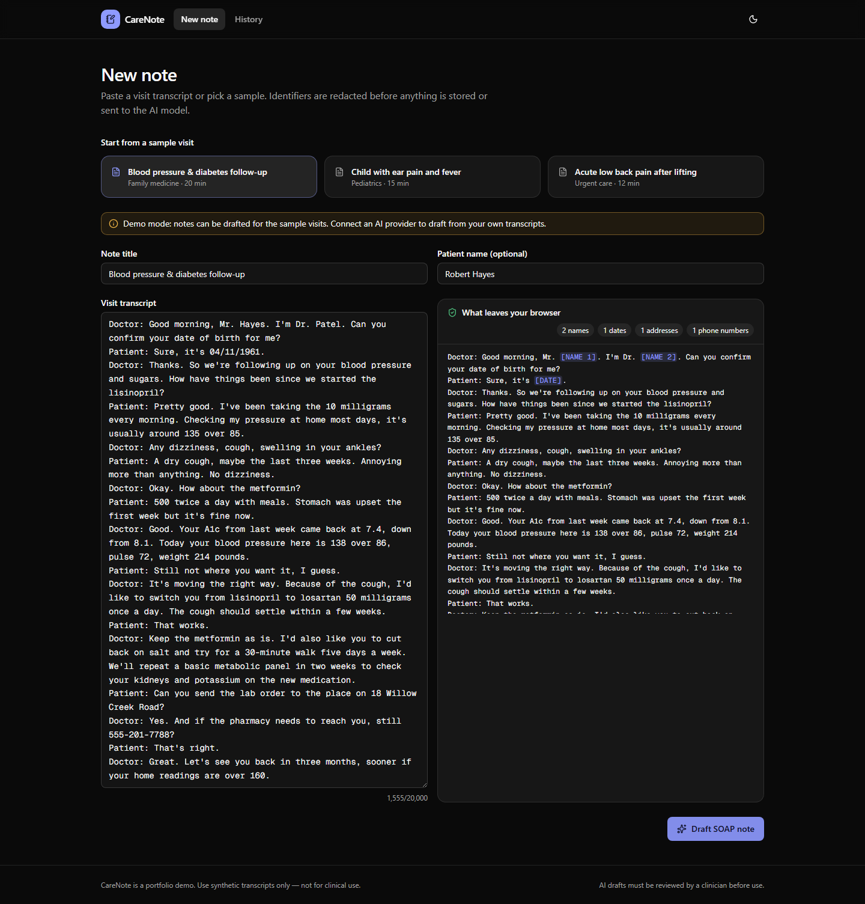
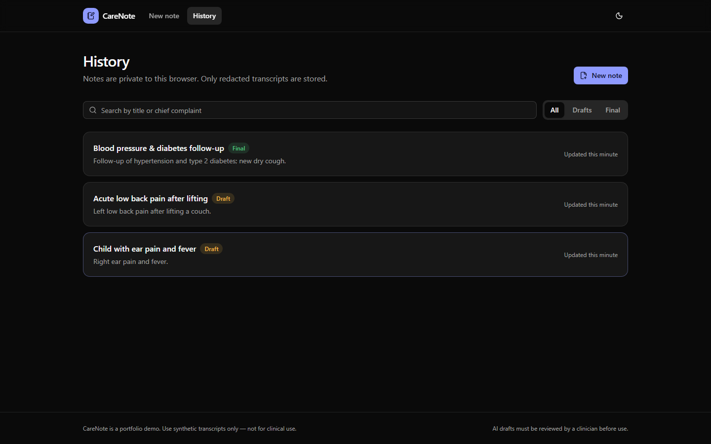
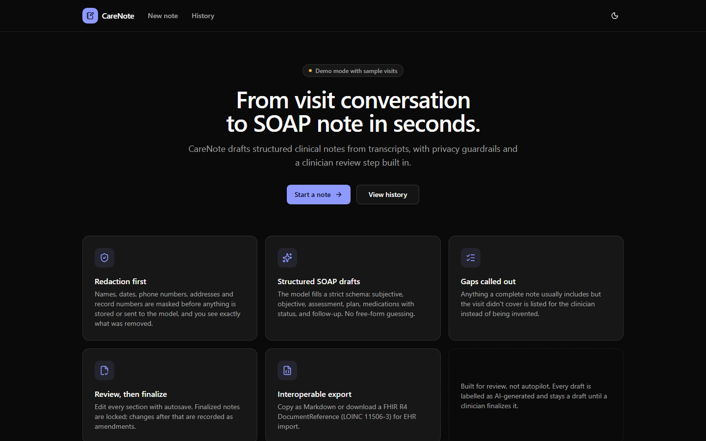
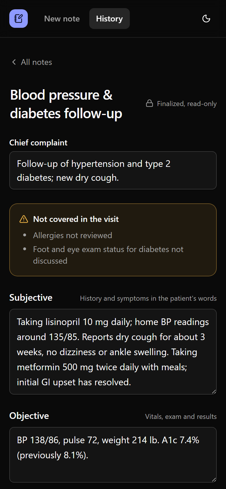

# CareNote: AI Clinical Documentation Assistant

[](https://github.com/Mdjamilh/care-note-ai/actions/workflows/ci.yml)


CareNote turns a doctor–patient visit transcript into a structured, editable **SOAP note**. Identifiers are redacted **before** anything is stored or sent to the model, the draft calls out what the visit didn't cover instead of inventing it, and nothing is final until a clinician reviews and locks it.

**Live demo:** https://carenote-ai-nine.vercel.app (demo mode: pick a sample visit on **New note**)

> Portfolio project. Use synthetic transcripts only. AI drafts must be reviewed by a clinician; not for clinical use.



## Features

- **PHI redaction first.** Names, dates, phone numbers, emails, SSNs, record numbers, street addresses, ZIP codes, URLs and ages over 89 are replaced with placeholders such as `[NAME 1]` or `[DATE]`, based on the HIPAA Safe Harbor identifier list. The same person always gets the same placeholder, so the model can still tell people apart.
- **See what leaves the browser.** A live preview highlights every placeholder and counts what was removed, before you draft.
- **Structured SOAP drafts.** Claude fills a strict JSON schema: chief complaint, subjective, objective, assessment, plan, medications (new, continued, changed or stopped) and follow-up.
- **Gaps, not guesses.** Anything a complete note normally has but the visit didn't cover (allergies, vitals and so on) is listed in a "Not covered in the visit" checklist.
- **Review workflow.** Edit every section with debounced autosave. Finalizing locks the note; later changes are made as an amendment, which is a new draft.
- **Export.** Copy or download Markdown, or download a FHIR R4 `DocumentReference` (LOINC 11506-3, Progress note) for EHR import.
- **Private by default.** Each browser gets an anonymous workspace, so demo visitors never see each other's notes. Only redacted transcripts are persisted.
- **Demo mode.** Without an API key, the three built-in synthetic visits produce hand-written reference notes, so the live demo works for free.

| | |
|---|---|
|  |  |
|  |  |

## Tech stack

| Layer | Choice |
|---|---|
| Framework | Next.js 15 (App Router, Server Components, Server Actions, Middleware) |
| Language | TypeScript (strict) |
| UI | Tailwind CSS v4, shadcn/ui (Radix), lucide icons, dark-first theme |
| AI | Claude API via `@anthropic-ai/sdk`: structured output from a Zod schema, server-side refusal fallback |
| Database | PostgreSQL via Drizzle ORM, with JSONB note content; embedded PGlite when no `DATABASE_URL` is set |
| Validation | Zod on every server action, plus re-validation of model output |
| Testing | Vitest (unit and integration on real Postgres), Playwright (desktop and mobile end-to-end) |
| CI | GitHub Actions: lint, typecheck, unit tests, build, e2e in the official Playwright container |

## How a note is drafted

```
transcript ─► redactPhi() ─► [redacted text] ─► Claude (JSON schema) ─► Zod validation ─► notes table
                 │                                                                            ▲
                 └── raw transcript and patient name are discarded here ──────────────────────┘
                                                            (only redacted text + note stored)
```

The raw transcript and the optional patient name exist only for the length of the request. See [docs/ARCHITECTURE.md](docs/ARCHITECTURE.md) for details.

## Getting started

Requires Node.js 20 or newer.

```bash
git clone https://github.com/Mdjamilh/care-note-ai.git
cd care-note-ai
npm install
npm run dev
```

Open http://localhost:3000, choose **New note**, pick a sample visit and click **Draft SOAP note**.

### Environment variables

Copy `.env.example` to `.env.local`. Everything is optional.

| Variable | Purpose |
|---|---|
| `ANTHROPIC_API_KEY` | Enables drafting from any transcript. Without it the app runs in demo mode. |
| `ANTHROPIC_MODEL` | Model override. Default `claude-opus-5-5`. |
| `DATABASE_URL` | Postgres connection string (for example Neon). Without it, embedded PGlite is used. |
| `DRAFT_RATE_LIMIT` | Drafts per IP per minute. Default 6. |

## Scripts

| Command | What it does |
|---|---|
| `npm run dev` | Development server |
| `npm run build` / `npm start` | Production build and server |
| `npm run lint` / `npm run typecheck` | ESLint and `tsc --noEmit` |
| `npm test` | Vitest unit and integration tests |
| `npm run test:e2e` | Playwright tests against a production build (run `npm run build` first) |
| `npm run db:generate` / `npm run db:migrate` | Drizzle migrations |
| `npm run screenshots` | Re-capture the README screenshots from a running app |

## Testing

- **Redaction:** every identifier type, false positives such as blood pressure readings and doses, consistent numbering, and planted identifiers in the samples
- **Pipeline:** the generator only ever receives redacted text, and model output that doesn't match the schema is rejected
- **Repository (real Postgres):** workspace isolation, search, finalize locking and amendments
- **Export:** Markdown structure and FHIR `DocumentReference` with UTF-8 content
- **End-to-end:** redaction preview, draft → autosave → finalize → export → amend, history search and delete, and cross-browser privacy, on desktop and mobile

## Deploying to Vercel

Import the repository; no build settings need to change. Add `ANTHROPIC_API_KEY` to draft from custom transcripts, and optionally a Neon database (`DATABASE_URL`, then `npm run db:migrate`) for persistent notes. Without a database, each server instance keeps notes in memory.

## Limitations

- Pattern-based redaction is a safety net, not a guarantee. Unusual name formats can slip through, which is why the preview is shown before drafting.
- The anonymous workspace is a convenience for the demo, not authentication.

## License

[MIT](LICENSE)
